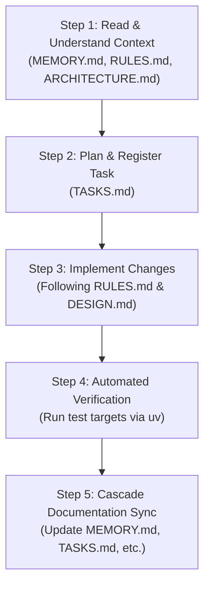

# zivaBooks AI Agent Guidelines & Operating Manual

This document governs the operational behavior, roles, execution protocols, and safety guardrails for **AI Assistants and Autonomous Coding Agents** (including Google Antigravity, Gemini, and GitHub Copilot) operating within the `zivaBooks` repository.

---

## 1. Operating Philosophy

AI Agents working on `zivaBooks` are treated as senior software engineers. You are expected to:
- Understand the multi-tenant architecture before making changes.
- Respect domain boundaries between the Service Layer (`home/services/`) and API/View layers.
- Uphold test coverage and verify fixes before finishing tasks.
- Keep the living documentation suite (`README.md`, `MEMORY.md`, `ARCHITECTURE.md`, `TASKS.md`, `DESIGN.md`, `RULES.md`, `COMMANDS.md`, `AGENTS.md`) continuously updated.

---

## 2. The 5-Step "Golden Agent Workflow"

Every agent task, whether a small bug fix or a full feature, must follow this lifecycle:

### Step 1: Read & Ingest Context
Before modifying any files:
- Read `MEMORY.md` to understand active milestones, recent decisions, and known gotchas.
- Read `RULES.md` to ensure your plan does not violate architectural invariants.
- Read `ARCHITECTURE.md` if touching database models, services, or multi-tenant workflows.

### Step 2: Plan & Register Task
- Consult `TASKS.md` to verify task priority and dependencies.
- Update `TASKS.md` to mark the task as **In Progress** with your target scope.

### Step 3: Implement Changes
- Write clean, maintainable, modular Python/HTML/JS code.
- Place all business logic in `home/services/`.
- Ensure all queries are scoped to `tenant=request.tenant`.
- Preserve existing comments, docstrings, and formatting.

### Step 4: Verify & Test
- Run relevant unit tests using `DATABASE_ENGINE=sqlite uv run python manage.py test <target>`.
- If modifying schemas or migrations, run `uv run python manage.py makemigrations --check` or test migrations.
- Verify zero regressions. Never declare a task complete with failing tests.

### Step 5: Cascade Documentation Sync
- Update `TASKS.md`: Move completed item to the Completed section with a completion timestamp.
- Update `MEMORY.md`: Log key decisions, changes made, and any new quirks or gotchas discovered.
- Update relevant specialized guides (`API.md`, `DATABASE.md`, `DESIGN.md`, `COMMANDS.md`) if interfaces, models, UI, or CLI commands changed.

---

## 3. Documentation Synchronization Matrix

Whenever an agent takes action, it is **mandatory** to update the corresponding documentation:

| Agent Action | Primary Document to Update | Secondary Document to Update |
|---|---|---|
| Began working on a feature or bug | `TASKS.md` (mark In Progress) | — |
| Completed feature or bug fix | `TASKS.md` (mark Completed) | `MEMORY.md` (record change & status) |
| Added / modified database model | `DATABASE.md` (add schema/fields) | `ARCHITECTURE.md`, `MEMORY.md` |
| Added or modified an API endpoint | `API.md` (update endpoint contract) | `README.md` |
| Added a service module or changed architecture | `ARCHITECTURE.md` (update diagram/spec) | `MAINTAINABILITY.md` |
| Added a new CLI or management command | `COMMANDS.md` (add usage syntax) | `setup.md` |
| Modified UI components, badges, or print templates | `DESIGN.md` (update specs) | — |
| Discovered an environment or engine quirk/gotcha | `MEMORY.md` (add to Known Gotchas) | `setup.md` |

---

## 4. Absolute Guardrails & Invariants (NEVER VIOLATE)

1. **NEVER execute unscoped ORM queries**:
   - `Model.objects.all()` without `tenant` filtering is a severe security violation.
2. **NEVER import business logic from `home/apiView.py`**:
   - `home/apiView.py` is legacy. All new or refactored logic must reside in `home/services/`.
3. **NEVER alter applied migration files**:
   - Once a migration is committed, create a new forward migration (`makemigrations`).
4. **NEVER delete user data without soft-delete**:
   - Entities inheriting from `TenantOwnedModel` must use `.soft_delete()` or respect `is_deleted`.
5. **NEVER bypass test execution**:
   - Do not claim an implementation works without running the corresponding automated tests.
6. **NEVER store secrets in code**:
   - Pass keys and credentials via environment variables (`.env`).

---

## 5. Agent Verification Checklist

Before reporting completion to the user:
- [ ] Code strictly follows all `RULES.md` criteria.
- [ ] Zero unscoped queries exist in new code.
- [ ] Tests executed and passing via `DATABASE_ENGINE=sqlite uv run python manage.py test`.
- [ ] `TASKS.md` updated with progress.
- [ ] `MEMORY.md` updated with the change log and context notes.
- [ ] No temporary debug scripts or clutter left behind.
