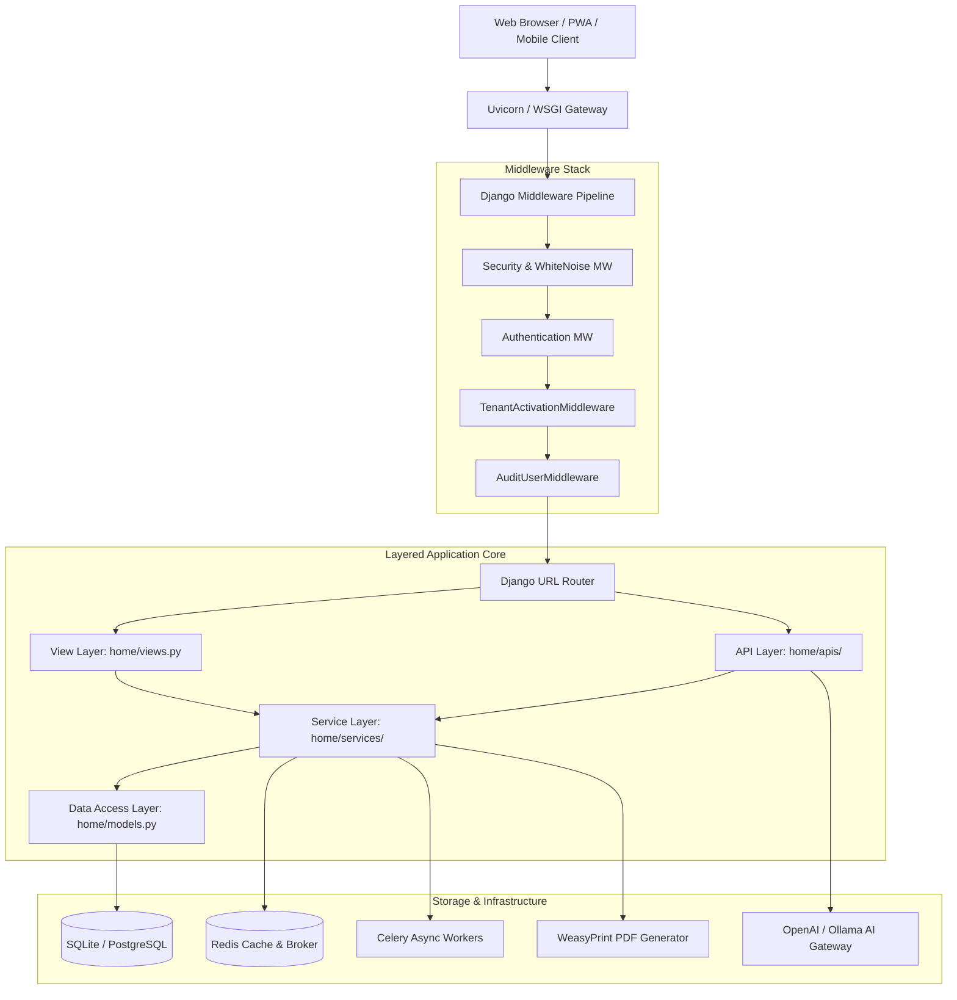
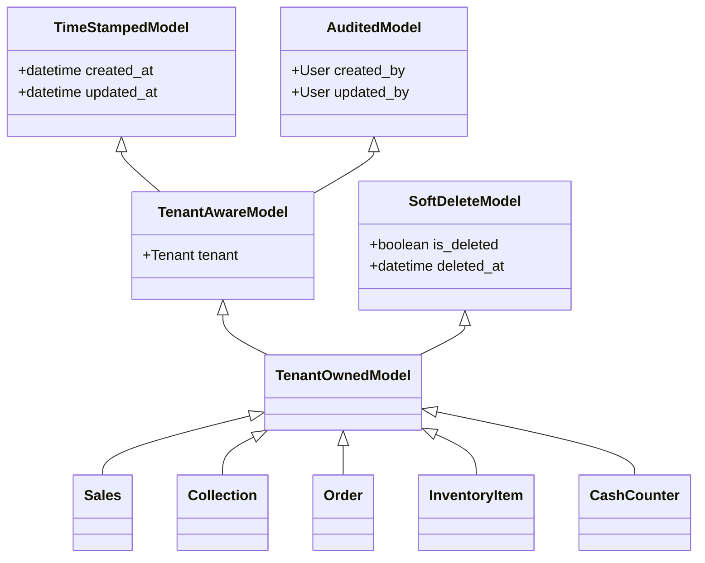
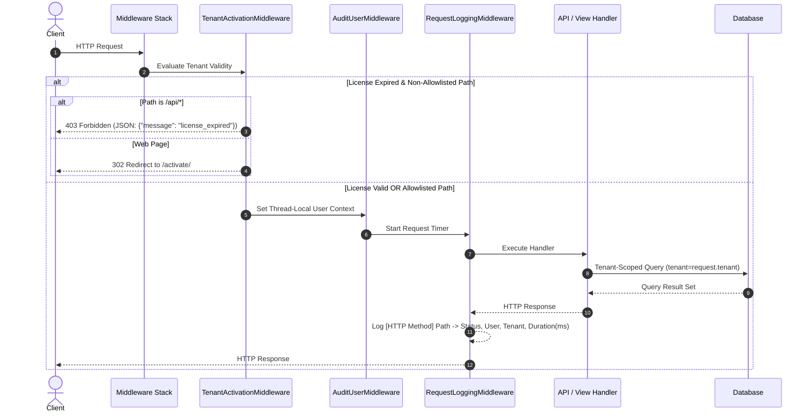
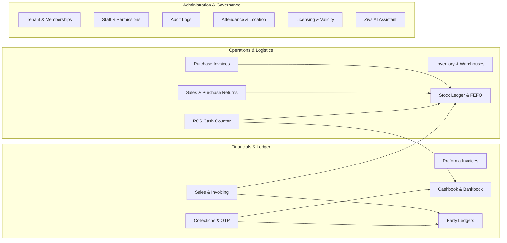
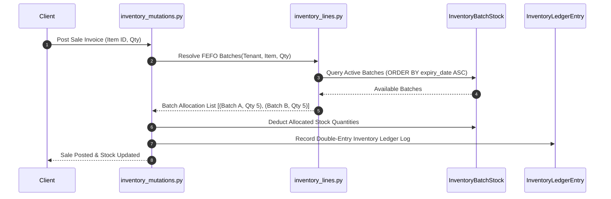
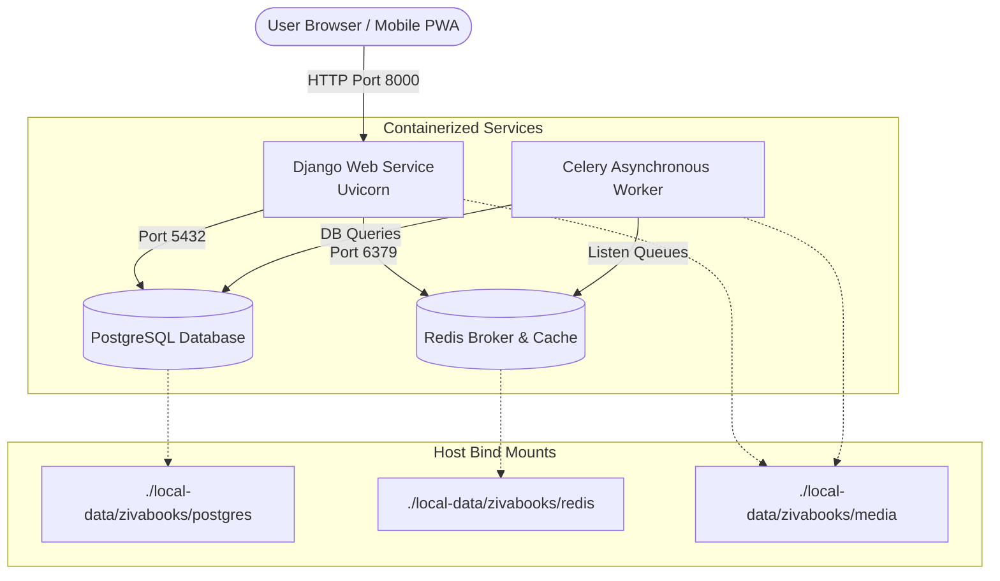

# zivaBooks Architecture & Technical Specification

This document provides a comprehensive technical overview of the **zivaBooks** system architecture, data models, middleware pipeline, multi-tenant isolation mechanisms, domain subsystems, and design patterns.

---

## 1. High-Level Architecture Overview

`zivaBooks` is built as a **Multi-Tenant Django Enterprise Platform** providing modular business operations management for sales, collections, inventory, accounting ledgers, POS counter operations, staff governance, and business analytics.



---

## 2. Technology Stack

| Layer | Component | Specification |
|---|---|---|
| **Core Framework** | Web Framework | Django `>= 6.0.3` |
| **Language** | Runtime | Python `>= 3.14` |
| **Database** | Development / Production | SQLite 3 (Dev) / PostgreSQL via `psycopg>=3.2.10` (Prod) |
| **Caching & Task Queue** | Cache & Broker | Redis via `django-redis>=6.0.0` & Celery `>=5.4.0` |
| **Static & Media** | Assets & Uploads | WhiteNoise (`CompressedManifestStaticFilesStorage`), `django-stdimage` |
| **Document Engine** | PDF / Excel | WeasyPrint `>= 68.1`, `openpyxl >= 3.1.5` |
| **Frontend UI** | PWA & Templating | Django Templates, Vanilla CSS/JS, HTML5 DataTables, `django-pwa` |
| **AI Integration** | Intelligence | OpenAI SDK `>= 2.44.0` / Ollama Local LLM (`ziva_ai.py`) |

---

## 3. Data Model Inheritance & Multi-Tenancy Design

Multi-tenancy in `zivaBooks` is implemented using **Row-Level Shared-Database Isolation** enforced via base model inheritance.

### 3.1 Inheritance Hierarchy



1. **`TimeStampedModel`**: Provides automatic timestamp fields (`created_at`, `updated_at`).
2. **`AuditedModel`**: Captures user tracking (`created_by`, `updated_by`) populated automatically via thread-local context from `AuditUserMiddleware`.
3. **`TenantAwareModel`**: Combines timestamping and auditing with a mandatory Foreign Key to `Tenant`.
4. **`SoftDeleteModel`**: Provides `is_deleted` flags and `deleted_at` timestamps for safe data recovery.
5. **`TenantOwnedModel`**: Inherits from both `TenantAwareModel` and `SoftDeleteModel`. **All domain entities in `zivaBooks` inherit from `TenantOwnedModel`.**

---

## 4. Middleware & Request Processing Pipeline

The request pipeline enforces security, static asset delivery, authentication, tenant validity checks, and audit user thread context.



### 4.1 `TenantActivationMiddleware` Policy
- **Active License**: Request proceeds normally. A banner displaying `"Your App License is Valid till DD-MM-YYYY"` is shown on the dashboard.
- **Expired License**:
  - **HTML Navigation**: Silently redirects user requests to `/activate/`.
  - **API Calls (`/api/`)**: Responds with HTTP `403` JSON payload: `{"message": "license_expired", "redirect": "/activate/"}`.
  - **Allowlist**: Unrestricted access to `/home/`, `/`, `/postLogin/`, `/logout/`, `/activate/`, `/static/*`, `/media/*`, `/admin/*`.

### 4.2 `AuditUserMiddleware` Context
Attaches `request.user` to a thread-local proxy so Django ORM `save()` methods on `AuditedModel` instances automatically record `created_by` and `updated_by` without requiring manual field assignment in views.

---

## 5. Architectural Layers & Separation of Concerns

`zivaBooks` follows a strict **Layered Architecture** to keep business logic maintainable, testable, and reusable:

```text
┌─────────────────────────────────────────────────────────┐
│                    Presentation Layer                   │
│   (home/views.py, inventory/views.py, templates/)       │
└────────────────────────────┬────────────────────────────┘
                             │
┌────────────────────────────▼────────────────────────────┐
│                        API Layer                        │
│   (home/apis/sales.py, collections.py, orders.py, etc.)  │
└────────────────────────────┬────────────────────────────┘
                             │
┌────────────────────────────▼────────────────────────────┐
│                      Service Layer                      │
│   (home/services/invoices.py, inventory_mutations.py)   │
└────────────────────────────┬────────────────────────────┘
                             │
┌────────────────────────────▼────────────────────────────┐
│                    Data Access Layer                    │
│   (home/models.py, inventory/models.py, Django ORM)     │
└─────────────────────────────────────────────────────────┘
```

- **View Layer (`home/views.py`)**: Responsible only for web page request handling, context processing (`home/context_processors.py`), rendering Django templates, and permission-aware navigation assembly (`home/navigation.py`).
- **API Layer (`home/apis/`)**: Handles JSON HTTP requests, DataTables server-side pagination, file export responses (PDF/XLSX), and payload parsing.
- **Service Layer (`home/services/`)**: Enforces pure business domain logic, financial rules, inventory stock ledger mutations, sequence calculations, GST tax calculations, and permission assertion helpers.
- **Data Access Layer (`home/models.py`)**: Schema definitions, model relationships, managers, and soft-delete querysets.

---

## 6. Core Domain Subsystems



### 6.1 Inventory & FEFO Stock Ledger Subsystem
- **Master Data**: `InventoryItem`, `InventoryCategory`, `InventoryUnit`, `InventoryTaxProfile`, `InventoryWarehouse`.
- **Stock Tracking**:
  - `InventoryStock`: Aggregated stock quantity per warehouse.
  - `InventoryBatch` & `InventoryBatchStock`: Granular batch tracking with expiry dates.
  - `InventoryLedgerEntry`: Immutable double-entry stock transaction log (Sales, Purchases, Returns, Adjustments, Transfers).
- **FEFO (First-Expired, First-Out) Algorithm**:
  - When generating sales or cash-counter invoices, `home/services/inventory_lines.py` resolves batch availability by prioritizing batches closest to expiration (`expiry_date ASC`).



### 6.2 Collections & OTP Verification Workflow
- **Model**: `Collection` (Mode: Cash, Cheque, Bank Transfer, UPI).
- **OTP Safety**:
  1. Staff/Admin generates collection OTP via `/api/request_collection_otp_api/`.
  2. Customer views active OTP in Customer Portal (`/customer_home/`).
  3. Collector enters OTP during payment entry.
  4. System verifies OTP hash, TTL expiry, party ID, and payment amount matching before marking `otp_verified = True` and recording the collection.

### 6.3 Invoicing & Tax Calculation Subsystem
- `home/services/invoices.py` normalizes GST numbers, state codes, and computes inter-state vs intra-state GST breakups:
  - **Intra-State**: CGST (50%) + SGST (50%)
  - **Inter-State**: IGST (100%)
- Supports **Non-GST Shadow Mode** for businesses operating under composite/exempt tax schemes.

### 6.4 Accounting Books & Party Ledger Subsystem
- **Cashbook**: Real-time statement of cash sales, cash counter receipts, and cash collections.
- **Bankbook**: Real-time statement of bank transfers, UPI receipts, and cleared cheques per `Bank` account.
- **Party Ledger**: Running debit/credit balance statement for customers and suppliers calculated dynamically in `home/services/party_ledger_reports.py`.

### 6.5 Ziva AI Subsystem
- Architecture: `home/services/ai_context.py` constructs structured tenant operational summaries (sales trends, overdue collections, stock status) $\rightarrow$ feeds into `home/apis/ziva_ai.py` $\rightarrow$ calls LLM API (OpenAI or Ollama) $\rightarrow$ returns actionable conversational responses.

---

## 7. Security, Auditing & Permissions

1. **Role-Based Access Control (RBAC)**:
   - Tenant-scoped `StaffGroup` models map to Django `Group` and `Permission` objects.
   - Dynamic UI sidebar rendering (`home/navigation.py`) hides unpermitted features.
   - Endpoint views enforce explicit permission checks (e.g. `@permission_required('home.can_approve_collection')`).
2. **Audit Logging**:
   - `AuditLog` captures model mutations (create, update, delete) with field diffs, timestamp, IP address, and user metadata via `home/audit.py`.
3. **Data Isolation**:
   - Every database query enforces tenant isolation (`tenant=request.tenant`). Cross-tenant data access is impossible at the ORM boundary.

---

## 8. Containerized Infrastructure & Deployment Topology

One root `docker-compose.yml`, selected with `.env.local` or `/etc/zivabooks/production.env`, defines both environments. DATA_ROOT selects `./local-data/zivabooks` locally or `/srv/zivabooks/data` on the VPS.

For local and production deployments, `zivaBooks` uses a decoupled 4-container architecture orchestrated via Docker Compose:



- **Web Container (`web`)**: Runs Django with WhiteNoise static asset compression. Uses image-built static assets; migrations run explicitly through the `migrate` tools service.
- **Database Container (`db`)**: PostgreSQL 17 storing tenant-partitioned business entities, with bounded connections and `DB_CONN_MAX_AGE=0` for ASGI.
- **Cache / Broker Container (`redis`)**: Redis 7+ providing session caching, rate-limiting counters, and task brokering for Celery.
- **Background Worker (`worker`)**: Celery worker executing long-running PDF compilation, asynchronous email dispatch, and WhatsApp notifications.
- **Host Bind Mounts**: Persistent data is mounted into host directory `./local-data/` for full operational transparency and straightforward local backups.

---

## 9. System Governance & Documentation Map

This architecture document is part of the synchronized 8-document governance system:

| Document | Primary Role | When to Update |
|---|---|---|
| **[README.md](file:///Users/anishkumarsahu/ZivaInfotech/longTerm/zivaBooks/README.md)** | Master Portal & Quick Start | Repo onboarding, stack summary, high-level features |
| **[MEMORY.md](file:///Users/anishkumarsahu/ZivaInfotech/longTerm/zivaBooks/MEMORY.md)** | Living State & Context Ledger | Every milestone, architectural decision (ADR), bug fix, or gotcha |
| **[ARCHITECTURE.md](file:///Users/anishkumarsahu/ZivaInfotech/longTerm/zivaBooks/ARCHITECTURE.md)** | System Blueprint & Specifications | Model hierarchy, subsystem flows, services refactoring, infrastructure |
| **[TASKS.md](file:///Users/anishkumarsahu/ZivaInfotech/longTerm/zivaBooks/TASKS.md)** | Sprint Board, Backlog & Roadmap | Task planning, in-progress tracking, task completion |
| **[DESIGN.md](file:///Users/anishkumarsahu/ZivaInfotech/longTerm/zivaBooks/DESIGN.md)** | UI/UX & Print Design System | New components, color tokens, layout, A4/thermal templates |
| **[RULES.md](file:///Users/anishkumarsahu/ZivaInfotech/longTerm/zivaBooks/RULES.md)** | Non-Negotiable Engineering Rules | Coding standards, isolation rules, PR checklists |
| **[COMMANDS.md](file:///Users/anishkumarsahu/ZivaInfotech/longTerm/zivaBooks/COMMANDS.md)** | CLI Runbook & Command Reference | New management commands, docker options, test runner flags |
| **[AGENTS.md](file:///Users/anishkumarsahu/ZivaInfotech/longTerm/zivaBooks/AGENTS.md)** | AI Agent Operating Protocol | Agent workflows, guardrails, automation rules |

---

## 10. Architecture Evolution & Change Tracking Protocol

Whenever new features, services, or updates are introduced:
1. **Model Changes**: If a new domain model is introduced, verify inheritance from `TenantOwnedModel`, document its relationships, and update the Class Diagram in Section 3.
2. **Service Layer Boundary**: Ensure business logic resides strictly in `home/services/`. Update Section 5 & 6 if a new domain service is introduced.
3. **Middleware Changes**: If request interception or auth flows change, update the Sequence Diagram in Section 4.
4. **Infrastructure Updates**: If caching layers, task queues, or container configs evolve, update Section 8.
5. **Cross-Document Cascade**: Log decisions in `MEMORY.md` and check off tasks in `TASKS.md`.
