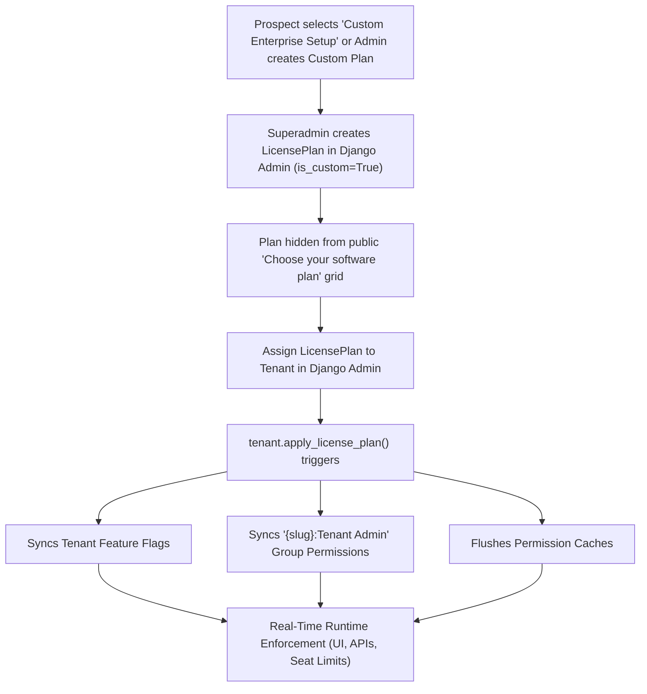

# Custom Tenant License Plans Guide - zivaBooks

A **Custom Tenant Plan** in **zivaBooks** allows system administrators to create tailored, bespoke subscription plans for specific businesses or high-volume enterprise clients. It provides complete control over **pricing**, **user seat capacity**, and any combination of **25+ granular subsystem feature toggles**.

---

## 🏗️ Architecture & Execution Flow



---

## 🛠️ Step-by-Step Admin Setup Guide

### 1. Create a Custom License Plan
Navigate to **Django Admin** -> **License Plans** (`/admin/home/licenseplan/add/`) and fill in:

1. **General Plan Information**:
   - `plan_code`: Unique string identifier (e.g., `custom_vip_enterprise`).
   - `name`: Human-readable display name (e.g., *Ziva Enterprise Custom VIP*).
   - `price_per_year`: Custom agreed annual price (e.g., `₹ 75,000.00`).
   - `original_price_per_year`: Original strikethrough price (optional, e.g., `₹ 99,999.00`).
   - `user_seats`: Allowed active staff user count (`0` for Unlimited, or custom number e.g., `50`).
   - `is_custom`: **Set to `True`** (hides custom plan from website public pricing grid).
   - `is_active`: Set to `True`.

2. **Configure 25+ Granular Subsystem Feature Modules**:

| Subsystem Category | Feature Toggle Code | Description |
| :--- | :--- | :--- |
| **Sales & Billing** | `sales_billing_enabled` | Core sales invoicing & billing module |
| | `proforma_estimates_enabled` | Proforma estimates, quotes & conversion |
| | `custom_invoice_series_enabled` | Custom invoice series prefix & auto-numbering |
| | `sales_returns_credit_notes_enabled` | Sales returns & credit notes |
| | `thermal_printing_enabled` | 3-inch Thermal POS printing |
| | `pdf_excel_exports_enabled` | A4 PDF & Excel report exports |
| **GST Compliance** | `gst_einvoicing_enabled` | Government GST Portal IRN E-Invoicing |
| | `eway_bill_enabled` | E-Way Bill generation & management |
| **Inventory & FEFO** | `inventory_enabled` | FEFO batch inventory control |
| | `fefo_batch_tracking_enabled` | Batch manufacturing & expiry tracking |
| | `multi_warehouse_enabled` | Multi-warehouse stock transfers |
| | `stock_adjustment_vouchers_enabled` | Physical stock audit adjustment vouchers |
| | `zero_stock_alerts_enabled` | Zero & expiry risk automated alerts |
| **Counter POS & OTP** | `multi_counter_pos_enabled` | Multi-counter POS cash registers |
| | `dual_otp_enabled` | Customer collection & delivery OTP validation |
| **Financial Accounts** | `cashbook_bankbook_enabled` | Cashbook & Bankbook ledger accounts |
| | `party_ledgers_enabled` | Party & customer ledger statements |
| | `double_entry_journals_enabled` | Double-entry journal vouchers |
| **Field Operations** | `gps_tracking_enabled` | Field staff real-time GPS location tracking |
| | `route_history_map_enabled` | Interactive daily route map history |
| | `geofenced_attendance_enabled` | Geofenced photo attendance check-in |
| **Ziva AI Assistant** | `ziva_ai_enabled` | Ziva AI business intelligence assistant |
| | `ziva_ai_max_queries_per_month` | Custom monthly AI credit quota (e.g. `10000`) |
| **Customer Portal** | `customer_portal_enabled` | 24/7 B2B Customer Self-Service Portal |
| | `customer_ledger_enabled` | Real-time Customer Ledger & KPI statements |
| | `customer_invoice_downloads` | Purchase Bills & PDF invoice downloads |
| | `customer_order_tracking` | Live Sales Order tracking & item dispatch status |
| **Security & Multi-Branch**| `multi_branch_isolation_enabled` | Multi-branch organization data isolation |
| | `custom_shadow_mode_enabled` | Category passcode control (Shadow Mode) |
| | `role_based_permissions_enabled` | Custom staff group role permissions |

3. **Custom Feature Bullet Points**:
   Enter human-readable feature bullet points as a JSON array e.g.:
   ```json
   [
     "Custom 50 Staff Seats Included",
     "Dedicated Account Manager",
     "Full GST E-Invoicing & E-Way Bill",
     "10,000 Monthly Ziva AI Credits"
   ]
   ```

---

### 2. Assign Plan to Tenant

Navigate to **Django Admin** -> **Tenants** (`/admin/home/tenant/`):

1. Open the target Tenant record (or create a new tenant).
2. Select the newly created custom plan from the **License Plan** dropdown (all plans, including custom ones, are selectable by superadmins in Django Admin).
3. Click **Save**.

---

## 🔒 Public Website Privacy & Exclusions

Custom plans are designed to be private agreements for specific clients and **must not appear on public pricing grids**:

1. **Model Query Protection (`LicensePlan.get_active_plans(include_custom=False)`)**:
   - By default, `get_active_plans()` filters out `is_custom=True` and any plan with code starting with `custom`.
   - Public APIs (`/api/license-plans/`) only return public standard plans (Starter, Growth, Enterprise).

2. **Login Page Template Filter (`login.html`)**:
   - The pricing card loop includes ``.
   - Ensures custom tenant plans are never displayed under *"Choose your software plan"* on the website landing/login page.

---

## ⚡ Under the Hood: Automatic Synchronization

When `tenant.apply_license_plan(custom_plan)` executes upon saving:

1. **Legacy Feature Flags Update**:
   Updates `tenant.inventoryEnabled`, `tenant.advancedInvoicingEnabled`, `tenant.einvoice_enabled`, `tenant.nonGstShadowEnabled`, and `tenant.enableAttendanceLocationMaps`.

2. **Permission Bundle Calculation (`home/permission_bundles.py`)**:
   `get_permissions_for_license_plan(custom_plan)` evaluates all enabled feature toggles and resolves matching permission strings (e.g., `home.can_access_ziva_ai`, `home.can_track_staff_location`).

3. **Django Permission Group Sync**:
   `sync_tenant_admin_group_permissions()` updates the Django Permission Group named `{slug}:Tenant Admin` with the exact permissions granted by the custom plan.

4. **Instant Cache Invalidation**:
   Clears `_tenant_permission_names_cache` on both the `request` and `tenant` objects. Active users see updated sidebar menus and feature cards immediately without logging out.

---

## 🛡️ Runtime Enforcement Mechanics

### 1. Route Access Protection (`@require_tenant_feature`)
If a staff user visits a URL for a feature disabled in the tenant's custom plan, the decorator catches it and renders a glassmorphic **403 Feature Locked screen**.

### 2. Dynamic Sidebar Navigation & Dashboard Cards
- Navigation menus automatically filter out items for disabled features.
- The dashboard (`/home/` or `/admin_home/`) checks `tenant_has_feature(tenant, feature_code)` before displaying metric cards (e.g., Attendance, Ziva AI, GPS Tracker).

### 3. Client-Side Pre-Call Suppression
Features like GPS autotracking inspect `tenant_has_feature(tenant, 'gps_tracking')` at the context processor level. When disabled, zero background network requests are generated.

### 4. Active Staff User Seat Validation (`check_staff_user_limit`)
- When creating or activating staff users:
  - If `user_seats > 0` and active staff count $\ge$ `user_seats`, the "Add User" button blocks modal opening and displays an orange/red error toast popup with upgrade instructions.
  - If `user_seats == 0`, staff seats are treated as **Unlimited**.

---

## 📬 Customer Inquiry Workflow (`ContactInquiry`)

1. Prospective clients select **"Custom Enterprise Setup"** on the pricing grid or contact modal.
2. The form posts to `/api/contact-inquiry/` and stores a `ContactInquiry` record in the database.
3. Sales/Admin reviews the request details, builds a custom `LicensePlan` (`is_custom=True`) in Django Admin, and assigns it to the tenant.
