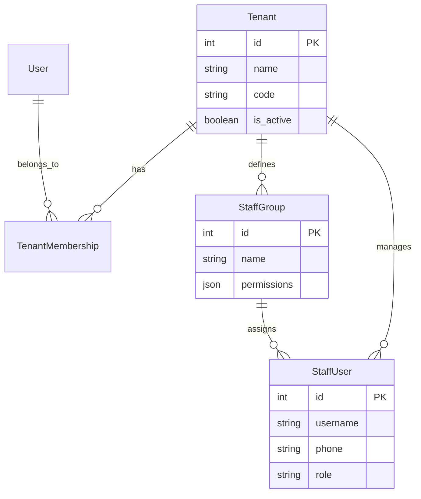
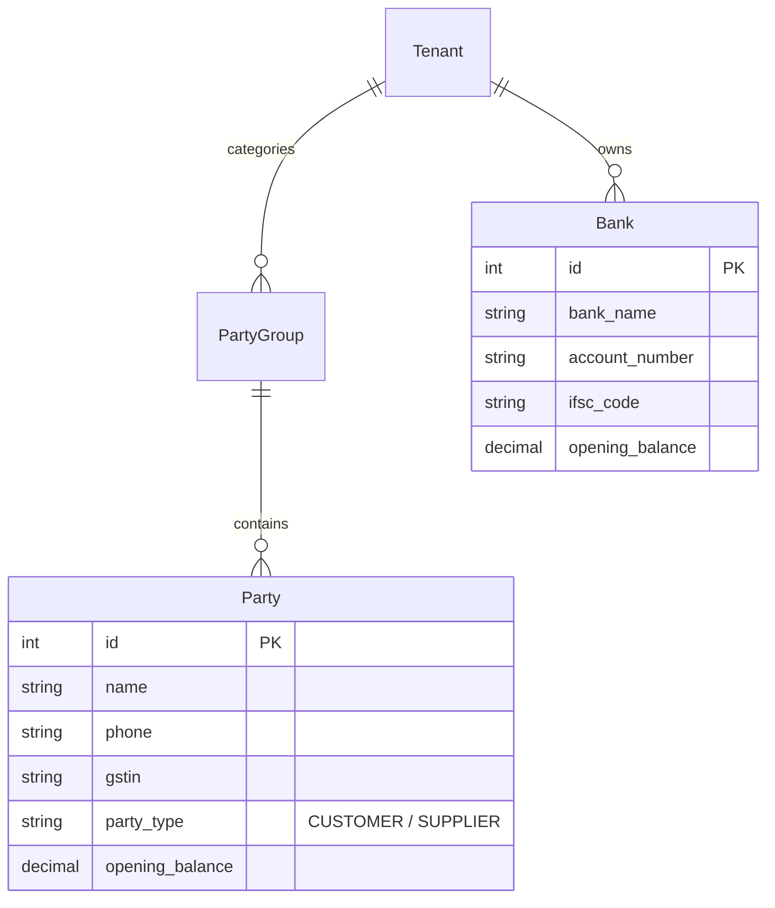
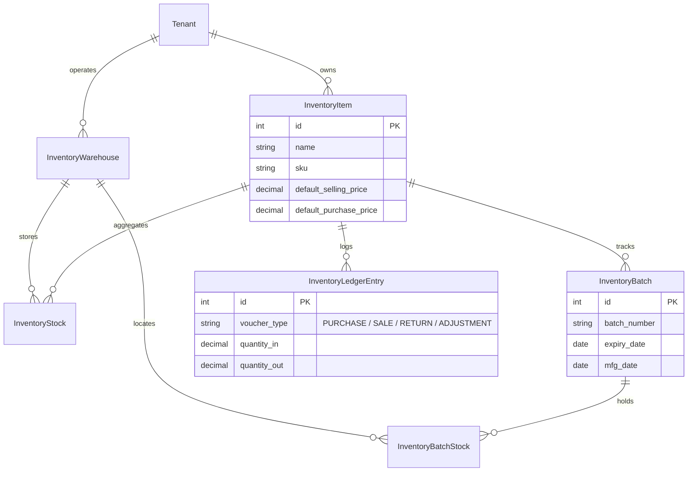
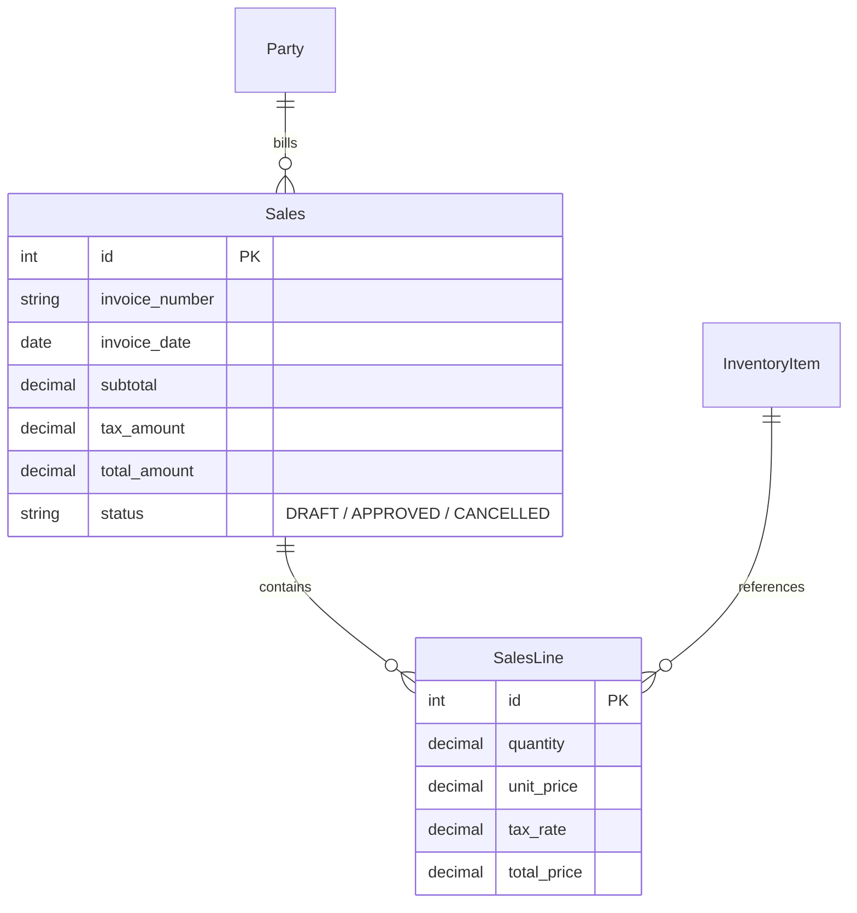
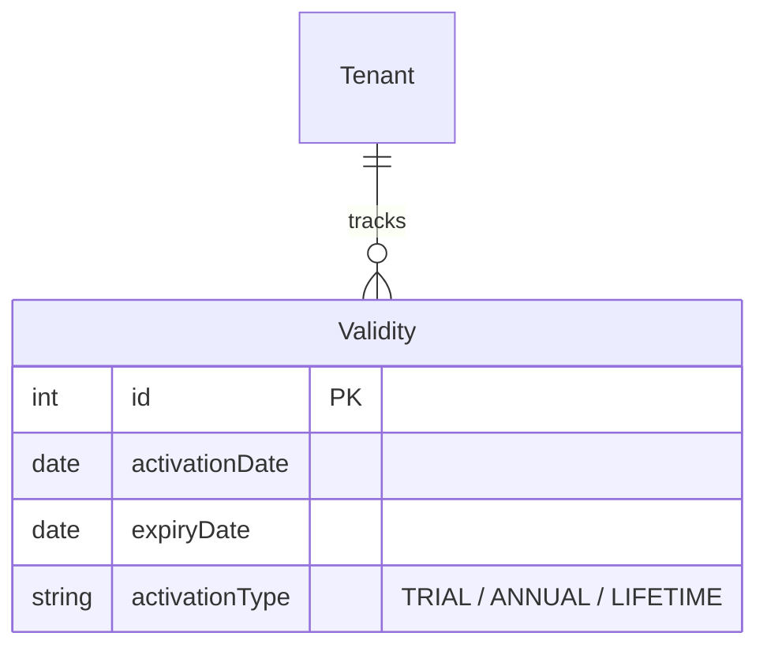

# zivaBooks Database Schema & Data Model Specification

This document provides a detailed overview of the database models, relationships, field definitions, indexes, and soft-delete mechanisms in **zivaBooks**.

---

## 1. Core Model Inheritance Architecture

```text
┌──────────────────────────────────────────────────────────┐
│                    TimeStampedModel                      │
│   created_at (DateTimeField), updated_at (DateTimeField) │
└────────────────────────────┬─────────────────────────────┘
                             │
┌────────────────────────────▼─────────────────────────────┐
│                      AuditedModel                        │
│   created_by (FK User), updated_by (FK User)             │
└────────────────────────────┬─────────────────────────────┘
                             │
┌────────────────────────────▼─────────────────────────────┐
│                    TenantAwareModel                      │
│   tenant (FK Tenant)                                     │
└────────────────────────────┬─────────────────────────────┘
                             │
┌────────────────────────────▼─────────────────────────────┐
│                     SoftDeleteModel                      │
│   is_deleted (BooleanField), deleted_at (DateTimeField)  │
└────────────────────────────┬─────────────────────────────┘
                             │
┌────────────────────────────▼─────────────────────────────┐
│                    TenantOwnedModel                      │
│   All zivaBooks domain models inherit from this class!   │
└──────────────────────────────────────────────────────────┘
```

---

## 2. Domain Model Subsystems

### 2.1 Multi-Tenant Core & Staff Administration



- **`Tenant`**: Root tenant model storing organization name, tenant code, active state, and configuration flags.
- **`TenantMembership`**: Links Django `User` accounts to `Tenant`s with default flags (`is_default`).
- **`StaffGroup`**: Custom group definition containing role permission sets mapped to Django `Permission` objects.
- **`StaffUser`**: Tenant staff profile linked to `User` and `StaffGroup`.

---

### 2.2 Counterparties & Financial Master Data



- **`PartyGroup`**: Categorizes parties (e.g. Retailers, Wholesalers, Distributors).
- **`Party`**: Customer or vendor master record with credit limits, GSTIN, and opening balance.
- **`Bank`**: Tenant bank account entity storing branch, account number, and balances.

---

### 2.3 Inventory & Stock Management



- **`InventoryStock`**: Current total stock quantity per item per warehouse.
- **`InventoryBatchStock`**: Current available stock quantity per item, per warehouse, per specific batch.
- **`InventoryLedgerEntry`**: Immutable transaction audit log tracking all physical inventory entries and exits.

---

### 2.4 Sales, Proforma & Purchasing



- **`Sales` & `SalesLine`**: Tax invoice headers and line items.
- **`ProformaInvoice` & `ProformaInvoiceLine`**: Estimates/quotes that convert into Sales Invoices.
- **`PurchaseInvoice` & `PurchaseLine`**: Inward stock purchase vouchers.
- **`CashCounter` & `CashCounterLine`**: POS counter sales transactions.

---

### 2.5 Licensing & Tenant Validity



- **`Validity`**: Records activation dates and expiry bounds evaluated dynamically by `TenantActivationMiddleware`.

---

## 3. Indexing Strategy & Performance Rules

All models inheriting from `TenantOwnedModel` implement compound indexes containing `tenant` to ensure high query performance:

```python
class Meta:
    indexes = [
        models.Index(fields=['tenant', 'is_deleted'], name='idx_tenant_deleted'),
        models.Index(fields=['tenant', 'created_at'], name='idx_tenant_created'),
    ]
```

**Database Performance Rules**:
1. **Always index `tenant`**: Queries MUST include `tenant_id` in compound indexes.
2. **Never delete rows directly**: Use soft deletion (`is_deleted=True`, `deleted_at=timezone.now()`) to maintain audit integrity.
