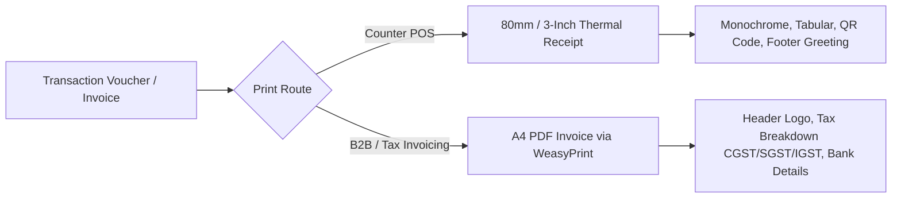

# zivaBooks — UI/UX Design System & Specification

This document outlines the user interface architecture, design tokens, component standards, and user experience patterns for **zivaBooks**.

---

## 1. Design Philosophy

`zivaBooks` is engineered for high-throughput daily business operations: wholesale billing counters, distribution warehouses, retail cash desks, and financial auditing desks. The design prioritizes:

1. **Information Density with High Legibility**: Fast data scanning without unnecessary visual clutter or oversized padding.
2. **Keyboard-Driven Workflow**: High-speed counter clerks must be able to complete billing, search items, and tender cash without leaving the keyboard.
3. **Defensive Financial UX**: State-changing operations (counter closures, voucher approval, OTP verification) use clear visual friction and confirmation modals.
4. **Offline & Mobile Resilience**: Clean PWA responsive shell with touch targets tailored for mobile field staff.

---

## 2. Design Tokens & Color Palette

### 2.1 Core Palette

```text
┌────────────────────────────────────────────────────────────────────────┐
│ PRIMARY BRAND (Indigo / Slate Navy)                                    │
│ Primary:   #2563EB (Tailwind Blue 600)   │ Dark: #1E40AF (Blue 800)     │
│ Surface:   #0F172A (Slate 900)          │ Nav:  #1E293B (Slate 800)     │
├────────────────────────────────────────────────────────────────────────┤
│ FUNCTIONAL STATUS COLORS                                               │
│ Success:   #059669 (Emerald 600)  - Paid, In Stock, Active, Verified   │
│ Warning:   #D97706 (Amber 600)    - Partial, Due Soon, Expiring Batch  │
│ Danger:    #DC2626 (Red 600)      - Overdue, Out of Stock, Expired     │
│ Info:      #0284C7 (Sky 600)      - Draft, Proforma, AI Assistant      │
├────────────────────────────────────────────────────────────────────────┤
│ NEUTRAL BACKGROUNDS & SURFACES                                         │
│ Body BG:   #F8FAFC (Slate 50)     │ Card BG:    #FFFFFF                │
│ Border:    #E2E8F0 (Slate 200)    │ Subtext:    #64748B (Slate 500)    │
└────────────────────────────────────────────────────────────────────────┘
```

### 2.2 Typography & Tabular Numerics
- **Body Font**: `-apple-system, BlinkMacSystemFont, "Segoe UI", Roboto, Helvetica, Arial, sans-serif`.
- **Accounting Numerics**: All currency values (`₹`), voucher numbers, ledger balances, and quantities use **Tabular Numbers** (`font-variant-numeric: tabular-nums`) to ensure vertical column alignment across reports.
- **Code & Barcode Font**: `SFMono-Regular, Menlo, Monaco, Consolas, "Liberation Mono", monospace` for HSN codes, batch numbers, and OTP inputs.

---

## 3. Layout & Application Shell

### 3.1 Desktop Shell
- **Left Navigation Sidebar**:
  - Dark slate theme (`#1E293B`) with tenant identity header and active module grouping.
  - Dynamic module visibility driven by the tenant's `LicensePlan` (disabled features are hidden or badged).
  - Quick tenant switcher and collapse toggle.
- **Top Header Bar**:
  - Global Search (`/` hotkey) for parties, inventory items, and invoice vouchers.
  - Ziva AI launcher button with monthly query count pill.
  - Active cash counter status indicator (Open / Closed).
  - User avatar with role badge (`Admin`, `Collector`, `Auditor`).
- **Main Workspace**:
  - Fluid grid with max width constraints for ultra-wide monitors.
  - Sticky breadcrumbs and action button bars (`Add Voucher`, `Export PDF`, `Export Excel`).

### 3.2 Mobile & PWA Shell
- **Bottom Navigation Bar**: Quick access to Home Dashboard, POS Billing, Collection Vouchers, and Menu.
- **Offline Shell**: Service Worker caches CSS, JS, and core UI templates (`django-pwa`). An offline banner alerts users when internet drops while allowing offline data entry.

---

## 4. Component Standards

### 4.1 DataTables & List Views
- **Server-Side Pagination**: High-performance pagination with AJAX queries (`django-datatables-view`).
- **Standard Columns**:
  - Column 1: Date & Voucher / Ref Number (linked to detail view).
  - Column 2: Party / Customer Name.
  - Column 3: Status Badge (e.g. `Paid`, `Partial`, `Pending OTP`).
  - Column 4: Amount / Total (`text-right`, tabular font).
  - Column 5: Action Menu (View, Edit, Print, Delete).

### 4.2 Status Badges

| State | CSS Class | Visual Display |
|---|---|---|
| **Paid / Approved** | `badge-success` | Light green background (`#DCFCE7`), dark green text (`#166534`) |
| **Partial / Pending OTP** | `badge-warning` | Light yellow background (`#FEF3C7`), dark yellow text (`#92400E`) |
| **Overdue / Expired** | `badge-danger` | Light red background (`#FEE2E2`), dark red text (`#991B1B`) |
| **Draft / Proforma** | `badge-info` | Light blue background (`#E0F2FE`), dark blue text (`#075985`) |

### 4.3 OTP Verification Dialog
- Centered modal with high-contrast numerical keypad input.
- Displays the payer's masked phone number (e.g., `+91 ******4520`).
- Features a 60-second countdown timer before enabling the `Resend OTP` button.
- Auto-focuses on the 4-to-6 digit input field and automatically submits on entry completion.

### 4.4 Printing Templates



1. **Thermal Receipt (80mm / 3-inch)**:
   - Compact monochrome layout formatted for POS receipt printers.
   - Includes business name, GSTIN, invoice series number, itemized lines, total summary, and verification QR code.
2. **A4 GST Tax Invoice**:
   - High-fidelity PDF rendered via **WeasyPrint**.
   - Full compliance with Indian GST rules: Buyer GSTIN, Place of Supply, HSN summary, CGST/SGST/IGST breakdown, authorized signature stamp.

### 4.5 Ziva AI Chat Drawer
- Slide-over drawer on the right side of the screen (`380px` desktop width).
- Natural language input bar with mic and send controls.
- Context cards displaying quick insights (e.g., *Today's Net Sales: ₹ 1,42,500*, *Top 3 Depleting Batches*).
- Markdown formatting for AI responses, including tabular data and quick-action links.

---

## 5. Interaction & Error Handling Patterns

1. **Asynchronous Form Submissions**:
   - All modal submissions use AJAX/Fetch.
   - Buttons display an inline spinner (`disabled` state) during submission to prevent double-charging or duplicate vouchers.
2. **Toast Notifications**:
   - Success toasts appear top-right with auto-dismiss after 4 seconds.
   - Error toasts persist until manually dismissed and show actionable error descriptions.
3. **Destructive Actions**:
   - Deletion of vouchers or party groups triggers a confirmation dialog requiring the user to confirm the action.
4. **License Expiry Overlay**:
   - When a tenant license lapses, a prominent warning banner appears on `/home/` and all non-allowlisted pages redirect cleanly to `/activate/`.
