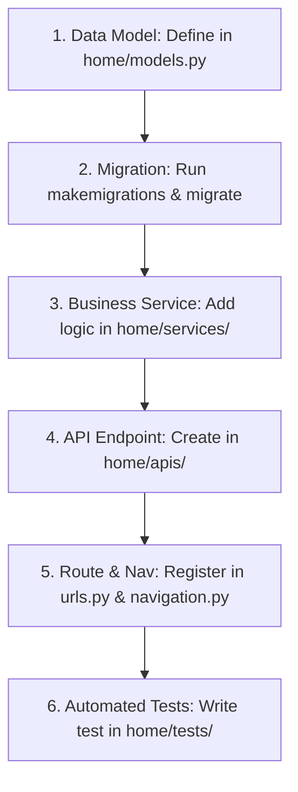

# zivaBooks Feature Development & Extension Guide

This guide provides step-by-step instructions for developers adding new features, APIs, database models, business logic, or UI pages to **zivaBooks**.

---

## 1. Feature Development Workflow Overview

Adding a new feature to `zivaBooks` follows a standard 6-step lifecycle:



---

## 2. Step-by-Step Implementation Guide

### Step 1: Create or Update Data Models

All multi-tenant data entities MUST inherit from `TenantOwnedModel` (defined in `home/models.py`).

```python
# home/models.py
from home.models import TenantOwnedModel
from django.db import models

class CustomFeature(TenantOwnedModel):
    name = models.CharField(max_length=255)
    description = models.TextField(blank=True, null=True)
    amount = models.DecimalField(max_digits=12, decimal_places=2, default=0)
    is_active = models.BooleanField(default=True)

    class Meta:
        indexes = [
            models.Index(fields=['tenant', 'name'], name='custom_feature_tenant_name_idx'),
        ]

    def __str__(self):
        return f"{self.name} ({self.tenant.name})"
```

**Key Model Rules**:
- Never omit `TenantOwnedModel` inheritance unless creating global configuration models.
- Always include composite indexes containing `tenant` for frequently queried fields.

---

### Step 2: Generate & Run Database Migrations

```bash
# Generate database migrations
uv run python manage.py makemigrations home

# Apply migrations
uv run python manage.py migrate
```

---

### Step 3: Implement Business Logic in Service Layer (`home/services/`)

Keep business rules, validation, GST formulas, and query shaping inside `home/services/`. Do not put heavy logic inside views or API handlers.

```python
# home/services/custom_feature.py
from home.models import CustomFeature
from django.core.exceptions import PermissionDenied

def get_custom_feature_queryset(tenant, user=None):
    """Return tenant-scoped queryset for custom features."""
    return CustomFeature.objects.filter(tenant=tenant, is_deleted=False)

def create_custom_feature_record(tenant, user, data):
    """Validate and create a new custom feature record."""
    if not user.has_perm('home.add_customfeature'):
        raise PermissionDenied("You do not have permission to add custom features.")

    record = CustomFeature.objects.create(
        tenant=tenant,
        name=data.get('name'),
        description=data.get('description', ''),
        amount=data.get('amount', 0),
        created_by=user,
        updated_by=user
    )
    return record
```

---

### Step 4: Create API Endpoints in API Layer (`home/apis/`)

Expose endpoints in `home/apis/` and return clean JSON responses.

```python
# home/apis/custom_feature.py
import json
from django.http import JsonResponse
from django.views.decorators.http import require_http_methods
from django.contrib.auth.decorators import login_required
from home.services.custom_feature import create_custom_feature_record, get_custom_feature_queryset

@login_required
@require_http_methods(["POST"])
def add_custom_feature_api(request):
    try:
        data = json.loads(request.body)
        record = create_custom_feature_record(
            tenant=request.tenant,
            user=request.user,
            data=data
        )
        return JsonResponse({
            "status": "success",
            "message": "Custom feature created successfully",
            "data": {"id": record.id, "name": record.name}
        }, status=201)
    except Exception as e:
        return JsonResponse({"status": "error", "message": str(e)}, status=400)
```

---

### Step 5: Register Routes & Update Navigation

#### A. Add URL Route (`home/urls.py`)
```python
# home/urls.py
from home.apis.custom_feature import add_custom_feature_api

urlpatterns = [
    # ... existing routes ...
    path('api/add_custom_feature/', add_custom_feature_api, name='add_custom_feature_api'),
]
```

#### B. Register Sidebar Item & Permission Bundle (`home/navigation.py`)
If the feature requires a menu item, add it to `home/navigation.py`:

```python
# Add item to sidebar section
{
    'name': 'Custom Features',
    'icon': 'feather icon-star',
    'url': reverse_lazy('homeApp:custom_feature_list'),
    'permission': 'home.view_customfeature',
}
```

---

### Step 6: Write Automated Tests (`home/tests/`)

Create a dedicated test file under `home/tests/`:

```python
# home/tests/test_custom_feature.py
from django.test import TestCase, Client
from home.models import Tenant, StaffUser, CustomFeature
from django.contrib.auth.models import User

class CustomFeatureTestCase(TestCase):
    def setUp(self):
        self.tenant = Tenant.objects.create(name="Test Tenant", code="TT")
        self.user = User.objects.create_user(username="testuser", password="password123")
        self.client = Client()
        self.client.login(username="testuser", password="password123")

    def test_create_custom_feature_tenant_isolation(self):
        # Create record for Tenant A
        feature = CustomFeature.objects.create(tenant=self.tenant, name="Feature A")
        self.assertEqual(feature.tenant, self.tenant)
        self.assertEqual(CustomFeature.objects.filter(tenant=self.tenant).count(), 1)
```

Run your new test to verify correctness:
```bash
uv run python manage.py test home.tests.test_custom_feature
```

---

## 3. Mandatory Coding Rules & Best Practices

1. **Always Scope Queries by Tenant**:
   - `CustomFeature.objects.filter(tenant=request.tenant)`
   - Never run `CustomFeature.objects.all()` without filtering by `tenant`.
2. **Never Import Shared Logic from Legacy Files**:
   - Do NOT import from `home/apiView.py` in new modules.
   - Import directly from modular service packages in `home/services/`.
3. **Handle Soft Deletes**:
   - Always include `is_deleted=False` in queries when fetching active records.
4. **Preserve URL Names**:
   - When refactoring existing views/APIs, keep URL names stable so reverse lookups like `reverse('homeApp:endpoint_name')` do not break.
5. **Enforce License Check Awareness**:
   - Remember `TenantActivationMiddleware` blocks non-allowlisted pages/APIs if the tenant license is expired. Ensure tests verify active vs expired tenant behavior.
